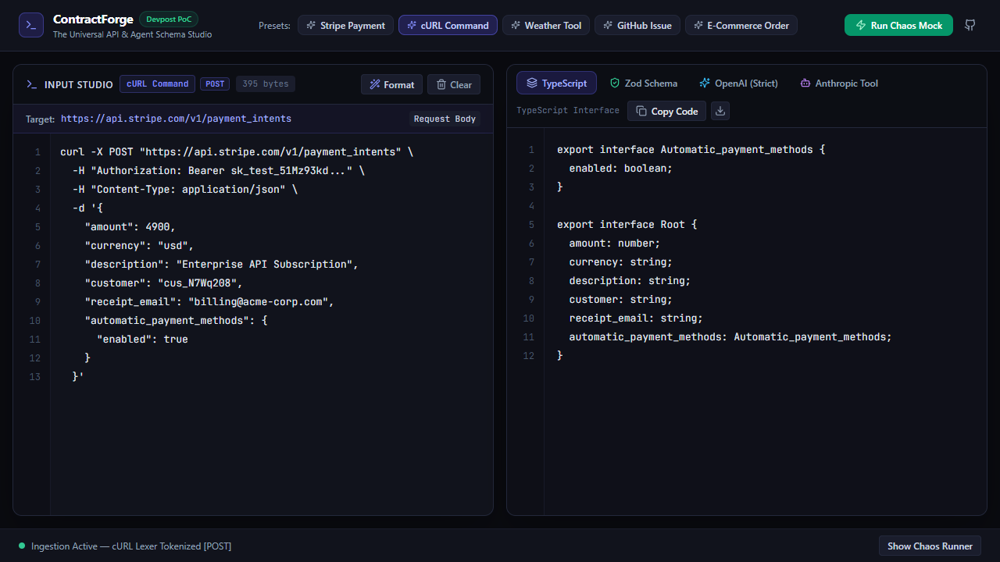
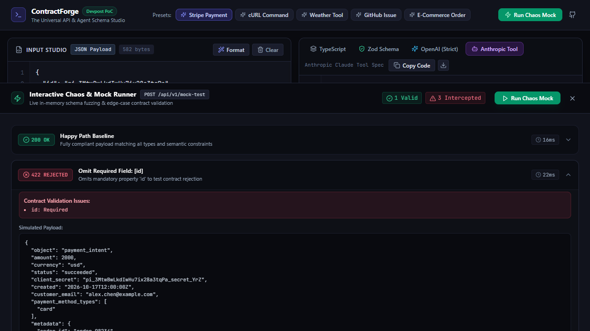
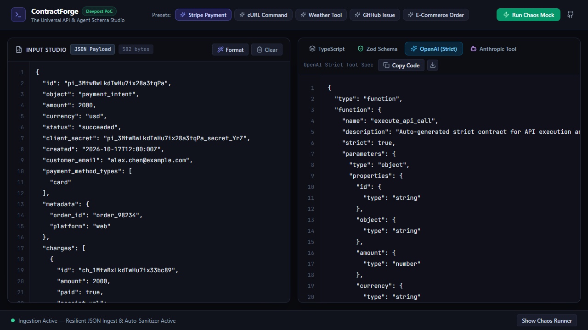
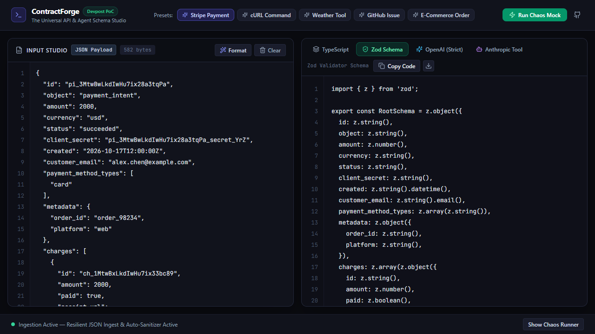

# ContractForge — The Universal API & Agent Schema Studio

> **Transform raw APIs and terminal cURLs into strict TypeScript, Zod, and AI Agent tool contracts in milliseconds—tested live with an in-browser, zero-backend Chaos Mock Runner.**
>
> Handwritten schemas for Autonomous Agent function calling are notoriously fragile. A single omitted `additionalProperties: false` or missing required null-union crashes OpenAI Strict Mode, while writing mock test harnesses takes hours. ContractForge eliminates this agony with a 100% client-side, zero-latency schema studio and edge-case fuzzer.

---

## ⚡ 30-Second Quickstart (Instant Judge Evaluation)

No API keys, no environment setup, no database, zero cost.

```bash
# 1. Clone & install dependencies
git clone https://github.com/Siddhant75/ContractForge.git
cd ContractForge
npm install

# 2. Run the studio locally (< 3 seconds)
npm run dev
# -> Opens instantly on http://localhost:5173
```

- **1-Click Zero-Typing Demo:** Once loaded, click the **"Stripe Payment"** or **"cURL Command"** preset pills in the top bar.
- **Run the Chaos Mock:** Click the green **"Run Chaos Mock"** button. Watch in-browser compiled schemas validate compliant payloads (`200 OK`) and intercept deterministic chaos mutations (`422 REJECTED`) in `< 20ms`.
- **Run Full Verification:**
  - `npm run test` (32 unit tests passing across all 6 test engines in `< 8s`)
  - `npm run test:e2e` (automated Playwright browser journey verifying UI, clicks, and contracts)
- **Demo Video Walkthrough:** Check [`recordings/demo-walkthrough.webm`](recordings/demo-walkthrough.webm) for the complete 1280x720 session capture.

---

## 📸 Visual Tour

| Studio Ingestion (cURL / JSON) | The In-Browser Chaos Mock Runner |
| :---: | :---: |
|  |  |

| OpenAI Strict Structured Outputs | Runtime Zod Validation Schema |
| :---: | :---: |
|  |  |

---

## 💡 The Problem & The Insight

1. **The LLM Tool Calling Fragility Trap:** Frontier AI agent platforms (OpenAI Structured Outputs, Anthropic Claude Tools) require unforgiving schema specifications. A single missing field in `required`, or an omitted recursive `additionalProperties: false`, causes API rejections and agent loop failures.
2. **The "Dirty Input" Reality:** Real developers copy raw cURLs from Chrome DevTools with shell escapes (`\`), authentication headers, trailing commas, and unquoted keys. Traditional JSON tools throw syntax errors and crash.
3. **The Mocking Tax:** Verifying that a generated contract handles edge cases traditionally requires deploying a mock server or writing boilerplate test harnesses. ContractForge compiles runtime validation schemas **directly in browser memory** and synthesizes edge-case mutations on demand.

---

## 🚀 How It Works (The 3-Step Engine)

```
[ Dirty Input: cURL / JSON ]
            │
            ▼
┌────────────────────────────────────────┐
│  1. Ingestion & Resilient Lexer        │  --> Normalizes shell quotes, extracts headers,
│     (src/engine/curlLexer.ts)          │      auto-sanitizes trailing commas & comments.
└────────────────────────────────────────┘
            │
            ▼
┌────────────────────────────────────────┐
│  2. AST & Semantic Inferrer            │  --> Builds canonical AST, resolves array unions,
│     (src/engine/schemaInferrer.ts)     │      detects ISO-8601, UUIDv4, email & URL formats.
└────────────────────────────────────────┘
            │
      ┌─────┴────────────────────────────┐
      ▼                                  ▼
┌───────────────────────────┐      ┌───────────────────────────┐
│  3A. 4 Multi-Target Specs │      │  3B. Chaos Mock Runner    │
│  - TypeScript Interfaces  │      │  - In-memory Zod compile  │
│  - Zod Runtime Schemas    │      │  - Happy Path (200 OK)    │
│  - OpenAI Strict Mode     │      │  - 3 Chaos Fuzz Mutations │
│  - Anthropic Claude Tools │      │    (422 REJECTED errors)  │
└───────────────────────────┘      └───────────────────────────┘
```

1. **Resilient Ingestion:** Tokenizes multi-line shell arguments, extracts HTTP methods (`POST`, `GET`, `PUT`), and auto-converts URL query parameters into schemas if no body is present. Malformed JSON with trailing commas or comments is auto-recovered with 1-click clean formatting.
2. **Semantic AST Inference:** Recursively analyzes structure up to 20 levels deep, computes key unions across array elements to mark optional properties (`?`), and detects semantic types (ISO timestamps, UUIDs, emails, URIs).
3. **Multi-Target Generation & Live Fuzzing:** Emits target code while dynamically compiling the schema in memory to execute deterministic chaos mutations without `eval()` or external servers.

---

## 🏆 Frontier AI Agent Standards & Sponsor Alignment

ContractForge directly targets the **Build With AI: Basics** objective: equipping developers to build robust, production-grade AI agent systems:

### 1. OpenAI Strict Structured Outputs (`openAiStrict.ts`)
Conforms 100% to OpenAI's strict mode specifications:
* `"strict": true` enforced at the root tool definition.
* Recursive `"additionalProperties": false` stamped onto **every single nested object schema**.
* **Every property included in `"required"`**: Optional keys are mathematically mapped to nullable unions (`anyOf: [baseSchema, { type: "null" }]`), preventing OpenAI API 400 rejection errors.

### 2. Anthropic Claude Tools (`anthropic.ts`)
Generates Claude-compatible tool definitions conforming to JSON Schema Draft 7 with sanitized tool naming, required property filtering, and descriptive schemas.

---

## 🤖 Model Context Protocol (MCP) Server for AI Agents

ContractForge is not only a visual web studio—it is also a headless **Model Context Protocol (MCP) Server**, allowing autonomous AI agents (in **Claude Code, Antigravity, Cursor, or Claude Desktop**) to synthesize and verify API tools on the fly.

### Exposed MCP Tools:

1. **`infer_contract`**: Pass raw cURL or JSON $\to$ returns mathematically compliant OpenAI Strict Mode, Claude Tool, TypeScript, or Zod schemas.
2. **`fuzz_contract`**: Compiles an in-memory Zod schema from an endpoint and runs live chaos mutations (200 OK baseline vs. 422 REJECTED errors) to identify mandatory parameters before the agent calls external APIs.
3. **`dynamic_tool_register`**: Synthesizes ready-to-register tool definitions with custom names and descriptions, allowing an agent to dynamically equip itself with new tools at runtime.

### Connect ContractForge to Claude Desktop, Cursor, or Antigravity:

Add to your `claude_desktop_config.json` or `.cursor/mcp.json`:

```json
{
  "mcpServers": {
    "contractforge": {
      "command": "node",
      "args": ["/path/to/ContractForge/bin/contractforge-mcp.js"]
    }
  }
}
```

*(Replace `/path/to/ContractForge` with the actual path to your cloned repository, or run `npm run mcp` directly).*

Now any connected agent can dynamically prompt:
> *"I need to integrate with this Stripe endpoint. Run `infer_contract` on this cURL and `fuzz_contract` to verify which parameters are mandatory."*

---

## 🛠️ Architecture & Technical Implementation

ContractForge is built as a **zero-backend, 100% client-side Single Page Application**:

* **Core Framework:** React 19 + TypeScript + Vite
* **Styling & Theme:** Tailwind CSS (Obsidian dark palette: `#090a0f`, elevated zinc cards, emerald & indigo accents)
* **Schema Validation & Compilation:** Zod 3.24
* **AI Agent Protocol:** Model Context Protocol (MCP) TypeScript SDK (`@modelcontextprotocol/sdk`)
* **Unit Testing Suite:** Vitest (32/32 unit tests passing across all engines)
* **E2E Browser Automation:** Playwright (Google Chrome automated test, 7 screenshots, session video recording)
* **Icons:** Lucide React
* **Hosting / Cost:** $0.00. No servers, no databases, no paid external APIs.

---

## 🧪 Verification & Test Suite

```bash
# Run 32 unit tests in Vitest (< 8 seconds)
npm run test

# Run Playwright E2E browser automation (headed or headless)
npm run test:e2e

# Start the headless MCP server for AI agents
npm run mcp

# Build production assets (zero TS errors, ~325kB bundle)
npm run build
```

---

## 📋 Devpost Learn Planning Artifacts

ContractForge strictly followed the Devpost Learn Hackathon lifecycle:
* [learner-profile.md](devpost/learner-profile.md) *(gitignored for privacy)*
* [scope.md](devpost/scope.md) & [scope.html](devpost/scope.html) *(approved)*
* [prd.md](devpost/prd.md) & [prd.html](devpost/prd.html) *(approved)*
* [spec.md](devpost/spec.md) & [spec.html](devpost/spec.html) *(approved)*
* [checklist.md](devpost/checklist.md) *(all 4 vertical slices completed & verified)*
* [app-map.html](devpost/app-map.html) *(visual architectural diagram & code tour)*

---

## 📄 License

MIT Open Source License. Built for the Devpost **Build With AI: Basics** Hackathon.
